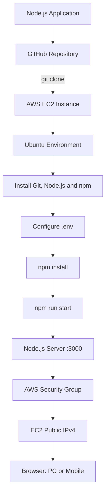
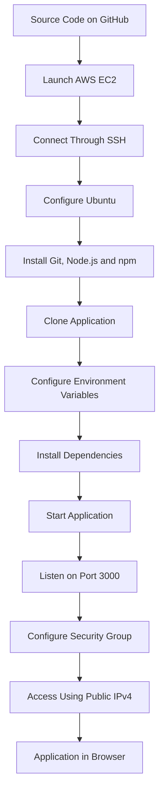

<h1 align="center"> Deploying a Node.js Application on AWS EC2</h1>

Deployed a Node.js application on an Ubuntu EC2 instance, configuring the runtime environment, application dependencies and networking rules.

Technologies Used: AWS EC2, Ubuntu, Node.js, Express.js, Git, npm

📖 [View My Full Project ](https://github.com/Yuvii2102/My-Devops-Cloud-Journey/blob/main/DevOps-Labs-and-Projects/03-AWS-EC2-Node%20Js-Deployment/README.md)

From a Node.js application to a live website using AWS EC2.

## 📌 Project Overview

In this project, I deployed a Node.js application on an AWS EC2 Ubuntu instance and made it accessible through the internet using the instance's public IPv4 address and port `3000`.

This hands-on project helped me understand how to deploy a web application on a cloud server, configure its runtime environment, manage dependencies, and allow incoming traffic through an AWS Security Group.

### 🎯 Project Objectives

- Create and configure an AWS EC2 instance.
- Connect to Ubuntu using SSH.
- Install Git, Node.js, and npm.
- Clone a Node.js application from GitHub.
- Configure application environment variables using `.env`.
- Install application dependencies.
- Start the application using npm.
- Configure inbound traffic through an AWS Security Group.
- Access the application using the EC2 public IPv4 address.

## 🧰 Technologies Used

| Technology | Purpose |
|---|---|
| ☁️ AWS EC2 | Hosts the application on a cloud server |
| 🐧 Ubuntu | Operating system on the EC2 instance |
| 🟢 Node.js | JavaScript runtime |
| 📦 npm | Installs and manages dependencies |
| 🚂 Express.js | Web application framework |
| 🐙 GitHub | Hosts the application's source code |
| 🔧 Git | Clones and manages source code |
| 🔐 AWS Security Groups | Controls network traffic |
| 🔑 Environment variables | Stores application configuration |
| 💳 Stripe | Payment integration used by the application |

## 🏗️ Deployment Architecture



## 🟢 Part 1 — Obtain and Test the Application

### 1. Clone the GitHub Repository

```bash
git clone https://github.com/verma-kunal/AWS-Session.git
cd AWS-Session
```

### 2. Configure Environment Variables

Create a `.env` file in the project root:

```env
DOMAIN=""
PORT=3000
STATIC_DIR="./client"

PUBLISHABLE_KEY="YOUR_STRIPE_PUBLISHABLE_KEY"
SECRET_KEY="YOUR_STRIPE_SECRET_KEY"
```

| Variable | Purpose |
|---|---|
| `DOMAIN` | Domain or host configuration used by the application |
| `PORT` | Port on which the server listens |
| `STATIC_DIR` | Directory containing the frontend/static files |
| `PUBLISHABLE_KEY` | Stripe publishable key |
| `SECRET_KEY` | Stripe secret key |

**Security note:** Replace the placeholder Stripe keys with valid credentials if required. Never publish your real secret key in GitHub, screenshots, or blog posts.

### 3. Install Dependencies

```bash
npm install
```

### 4. Start the Application

```bash
npm run start
```

Expected output:

```text
Server listening on port: 3000
```

The application is ready for local testing if the required configuration is present.

## ☁️ Part 2 — Set Up an AWS EC2 Instance

### 1. Access AWS

Open the AWS Management Console and navigate to:

`EC2 → Instances → Launch instances`

Use an IAM identity with only the permissions required for the task. Administrator access is not recommended for routine use.

### 2. Configure the Instance

| Configuration | Value |
|---|---|
| Operating system | Ubuntu |
| Instance type | `t2.micro` |
| Key pair | Create or select a key pair |
| Private key format | `.pem` |
| Application port | `3000` |

The instance type and availability depend on your AWS account, region, and current service offerings.

Download the private key securely and do not upload it to GitHub.

## 🔐 Part 3 — Connect to EC2 Using SSH

From your local terminal, connect to the instance:

```bash
chmod 400 instance.pem
ssh -i instance.pem ubuntu@YOUR_PUBLIC_IP
```

Replace `instance.pem` and `YOUR_PUBLIC_IP` with your actual values.

The default Ubuntu username for many Ubuntu EC2 images is `ubuntu`.

After a successful connection, the terminal prompt should look similar to:

```text
ubuntu@ip-172-31-31-76:~$
```

You are now connected to the remote Ubuntu server.

## 🐧 Part 4 — Configure Ubuntu

### 1. Update Package Lists

```bash
sudo apt update
```

This refreshes the package lists available to Ubuntu.

### 2. Install Git

```bash
sudo apt install git -y
git --version
```

Git is required to clone the application repository.

### 3. Install Node.js and npm

During this project, Node.js was reported as version `v22.22.1`.

The following commands install the Ubuntu repository versions of Node.js and npm:

```bash
sudo apt install nodejs npm -y
```

Verify the installation:

```bash
node -v
npm -v
```

If Ubuntu installs an incompatible Node.js version, use an appropriate supported installation method to install a version compatible with the project.

## 🚀 Part 5 — Clone the Application on EC2

Run these commands inside the EC2 terminal:

```bash
git clone https://github.com/verma-kunal/AWS-Session.git
cd AWS-Session
ls
```

The `ls` command lists the files and directories in the project.

## 🔑 Part 6 — Configure the `.env` File

Create or edit the environment file:

```bash
vim .env
```

Press `i` to enter insert mode and add the required configuration:

```env
DOMAIN=""
PORT=3000
STATIC_DIR="./client"

PUBLISHABLE_KEY="YOUR_STRIPE_PUBLISHABLE_KEY"
SECRET_KEY="YOUR_STRIPE_SECRET_KEY"
```

Replace the placeholders with the appropriate values. Keep the actual Stripe secret key private.

To save and exit Vim:

1. Press `Esc`.
2. Type `:wq`.
3. Press `Enter`.

Verify that the file exists:

```bash
ls -la
```

### Protect Environment Variables

Add `.env` to `.gitignore` if it is not already excluded:

```gitignore
.env
```

Do not commit real credentials to a public repository.

## 📦 Part 7 — Install Dependencies

Move into the application directory if you are not already there:

```bash
cd ~/AWS-Session
npm install
```

This installs the dependencies specified by the project's package configuration.

## ▶️ Part 8 — Start the Node.js Application

Run:

```bash
npm run start
```

Expected output:

```text
> stripe-integration@1.0.0 start
> node server.js

Server listening on port: 3000
```

The server should remain running while you test the application. If it exits or displays an error, inspect the terminal output before proceeding.

## 🔓 Part 9 — Configure the AWS Security Group

The application listens on port `3000`. The EC2 Security Group must allow the corresponding inbound traffic.

Navigate to:

`EC2 → Instances → Select instance → Security → Security groups → Inbound rules → Edit inbound rules`

Add the following rule for the learning deployment:

| Setting | Value |
|---|---|
| Type | Custom TCP |
| Protocol | TCP |
| Port range | `3000` |
| Source | `0.0.0.0/0` |

Save the changes.

**What does this rule do?**

It permits inbound TCP traffic from any IPv4 address to port `3000`. This makes the application reachable from the public internet when the other networking requirements are satisfied.

For production deployments, avoid exposing an application port broadly when it is not necessary. Prefer restricted access or a properly configured HTTPS endpoint.

## 🌐 Part 10 — Access the Deployed Application

Find the instance's current public IPv4 address in the EC2 console.

Open this address in your browser:

```text
http://YOUR_PUBLIC_IP:3000
```

Replace `YOUR_PUBLIC_IP` with the actual address assigned to your EC2 instance.

If the application is running and networking is configured correctly, you should be able to access it from your PC or mobile device.

**Important:** The public IPv4 address may change after stopping and starting an instance unless an Elastic IP or another stable addressing arrangement is used.

## 🔄 Complete Deployment Flow



## 🛠️ Troubleshooting

| Problem | What to check |
|---|---|
| `npm: command not found` | Install Node.js and npm, then verify with `node -v` and `npm -v`. |
| SSH connection fails | Check the key file, SSH username, public IP, and inbound TCP port `22`. |
| Browser cannot reach the application | Confirm the server is running, listening on the correct port, and allowed by the Security Group. |
| `npm install` fails | Review the error, Node.js compatibility, and package configuration. |
| Environment variables are missing | Check `.env`, the variable names, and how the application loads the file. |
| Application stops after disconnecting | The process may have ended with the SSH session; consider a process manager or service. |
| Application returns an error | Inspect the application logs and verify its required configuration. |

## 🔐 Security Best Practices

- Never upload `.pem` private keys or real API secrets to GitHub.
- Keep `.env` out of version control.
- Use least-privilege IAM permissions.
- Restrict inbound ports to the minimum necessary.
- Do not expose development ports publicly in production without a security review.
- Use HTTPS for public-facing applications.
- Consider a process manager, reverse proxy, and monitoring for a more reliable deployment.

## 📚 Key Learnings

Through this project, I gained hands-on practice with:

- Launching and accessing cloud infrastructure using AWS EC2.
- Connecting to a remote Linux server using SSH.
- Installing and verifying Git, Node.js and npm.
- Deploying a Node.js application from a GitHub repository.
- Managing application configuration through environment variables.
- Understanding TCP ports and AWS Security Groups.
- Accessing a cloud-hosted application through a public IPv4 address.
- Troubleshooting common application deployment issues.


## 🔗 Related Resources

- **Main Cloud & DevOps Journey:** https://github.com/Yuvii2102/My-Devops-Cloud-Journey
- **Hashnode Blog:** https://build-break-fix-diaries-with-yuvrajj.hashnode.dev/
- **Source application:** https://github.com/verma-kunal/AWS-Session

## 👨‍💻 Author

**Yuvraj**  
Cloud & DevOps Learner

*Learning by building, documenting, breaking and fixing — one project at a time.*
