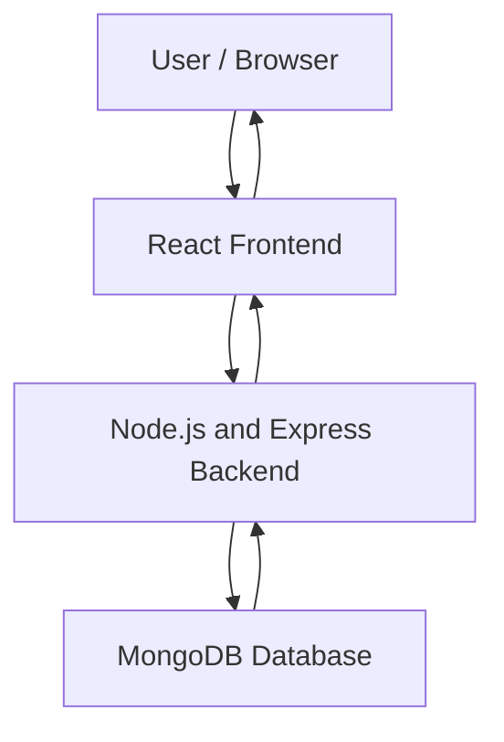

# MERN Stack Application Deployment Using Docker and Docker Compose

## 1. Project Introduction

In this project, I deployed a MERN stack application using Docker and Docker Compose on an AWS EC2 instance.

MERN stands for:

1. **MongoDB** – Database
2. **Express.js** – Backend framework
3. **React.js** – Frontend
4. **Node.js** – JavaScript runtime used for the backend

The application has three main parts:

- Frontend
- Backend
- Database

### How the application works

1. The user interacts with the frontend.
2. The frontend sends requests to the backend.
3. The backend processes the request.
4. The backend communicates with MongoDB to store or retrieve data.
5. The result is sent back to the frontend.

## 2. Project Architecture



## 3. Technologies Used

- AWS EC2
- Ubuntu
- Git
- GitHub
- Docker
- Docker Compose
- MongoDB
- Express.js
- React.js
- Node.js

## 4. EC2 Instance Configuration

First, I created an EC2 instance on AWS.

**Instance configuration:**

- Instance type: `t3.large`
- Storage: `30 GiB`
- Operating system: Ubuntu

After launching the instance, I connected to it using SSH.

### Check available memory and disk space

```bash
free -h
df -h
```

- `free -h` – Shows the available memory.
- `df -h` – Shows the available disk space.

## 5. Install Git

First, I installed Git on the EC2 instance.

```bash
sudo apt update
sudo apt install git -y
```

Check the Git version:

```bash
git --version
```

## 6. Install Docker

Next, I installed Docker Engine and Docker Compose on the EC2 instance.

After installing Docker, I started and enabled the Docker service.

```bash
sudo systemctl start docker
sudo systemctl enable docker
sudo systemctl status docker
sudo systemctl is-active docker
```

- `start` – Starts the Docker service.
- `enable` – Starts Docker automatically when the system boots.
- `status` – Shows the status of the Docker service.
- `is-active` – Checks whether the Docker service is active.

### Configure Docker permissions

By default, Docker commands may require `sudo`.

I added my Ubuntu user to the Docker group so that I could run Docker commands without typing `sudo` every time.

```bash
sudo usermod -aG docker ubuntu
```

Apply the group change:

```bash
newgrp docker
```

Now I can run Docker commands using my Ubuntu user.

## 7. Clone the GitHub Repository

I used the following repository for this project:

GitHub repository: [MERN Docker Compose](https://github.com/iam-veeramalla/MERN-docker-compose)

Clone the repository:

```bash
git clone https://github.com/iam-veeramalla/MERN-docker-compose.git
```

Go inside the project directory:

```bash
cd MERN-docker-compose
```

Check the available branches:

```bash
git branch -a
```

The repository contains two important branches:

- `main` – Contains the original application source code.
- `compose` – Contains the Dockerfiles and Docker Compose configuration.

Switch to the `compose` branch:

```bash
git checkout compose
```

### Understand the project structure

```bash
ls -R
```

This command displays the files and folders inside the project.

The project contains the frontend, backend and Docker Compose configuration.

## 8. Understand the MERN Application

Before creating Docker images, I understood the three main parts of the application.

### Frontend

The frontend is developed using React.js.

It is responsible for displaying the application to the user.

### Backend

The backend is developed using Node.js and Express.js.

It handles requests from the frontend and communicates with the database.

### Database

MongoDB stores the application data.

### Important ports

| Component | Port |
|---|---:|
| Frontend | 5173 |
| Backend | 5050 |
| MongoDB | 27017 |

## 9. Build the Frontend Docker Image

First, I moved inside the frontend directory.

```bash
cd mern/frontend
```

### Check the Dockerfile

I used `vim` to open and check the Dockerfile.

```bash
vim Dockerfile
```

I also used `cat` to display its contents.

```bash
cat Dockerfile
```

### Frontend Dockerfile

```dockerfile
FROM node:18.9.1

WORKDIR /app

COPY package.json .

RUN npm install

COPY . .

EXPOSE 5173

CMD ["npm", "run", "dev"]
```

### Explanation of the Dockerfile

**1. FROM node:18.9.1**

This is the base image for the frontend application.

It provides Node.js and npm.

**2. WORKDIR /app**

This creates and sets `/app` as the working directory inside the container.

**3. COPY package.json .**

This copies the package.json file into the working directory.

The package.json file contains the application dependencies.

**4. RUN npm install**

This installs the dependencies required by the frontend application.

**5. COPY . .**

This copies the remaining application source code into the container.

**6. EXPOSE 5173**

This specifies the port on which the frontend application runs.

**7. CMD ["npm", "run", "dev"]**

This command starts the frontend application.

The `dev` script is taken from the package.json file.

### Configure the frontend API address

Before building the frontend image, I configured the backend API address in the frontend source code.

The browser must be able to reach the backend using the EC2 public IP address.

I used the EC2 public IP address with port `5050` as the backend address.

For example:

```text
http://EC2_PUBLIC_IP:5050
```

I made this configuration before creating the frontend image so that the correct address would be included in the image.

**Important:** If the EC2 public IP changes, I need to update the API address in the frontend source code and rebuild the frontend image.

### Build the frontend image

Now I created the frontend Docker image.

```bash
docker build -t myfrontend .
```

**What happens during the build?**

1. Docker reads the Dockerfile.
2. It downloads the Node.js base image if required.
3. It creates the working directory.
4. It copies package.json.
5. It installs the dependencies using npm.
6. It copies the remaining source code.
7. It prepares the image to start the frontend application.

The `-t` option is used to give a name to the image.

The `.` tells Docker to use the current directory as the build context.

### Verify the frontend image

```bash
docker images
```

This displays the Docker images available on the EC2 instance.

I checked whether the `myfrontend` image was created successfully.

## 10. Create the Docker Network

Before running the containers, I created a Docker network.

```bash
docker network create mern
```

### Why do we need a Docker network?

In this project, we have three separate containers:

1. Frontend
2. Backend
3. MongoDB

These containers need to communicate with each other.

For example, when a user adds an employee record, the frontend sends the request to the backend. The backend then communicates with MongoDB to save the record.

To make this communication possible, I created a Docker network called `mern`.

When containers are connected to the same network, they can communicate with each other using their container names.

**In simple words:** The Docker network acts like a common connection between our containers. It allows them to communicate with each other.

## 11. Run the MongoDB Container

Next, I started the MongoDB container.

I used the MongoDB image available from Docker Hub.

```bash
docker run -d --network mern --name mongodb -p 27017:27017 -v ~/opt/data:/data/db mongo:latest
```

### Explanation

- `docker run` – Creates and starts a container.
- `-d` – Runs the container in the background.
- `--network mern` – Connects the container to the `mern` network.
- `--name mongodb` – Gives the container the name `mongodb`.
- `-p 27017:27017` – Maps port 27017.
- `-v ~/opt/data:/data/db` – Connects the EC2 directory to the MongoDB data directory inside the container.
- `mongo:latest` – Uses the MongoDB image.

### Verify the MongoDB image

```bash
docker images
```

This displays the MongoDB image along with the other available images.

I also checked the MongoDB connection:

```bash
docker exec mongodb mongosh --eval "db.runCommand({ ping: 1 })"
```

The successful response was:

```text
{ ok: 1 }
```

This confirmed that MongoDB was responding.

## 12. Build the Backend Docker Image

After starting MongoDB, I moved inside the backend directory.

```bash
cd ../backend
```

### Check the Dockerfile

I opened the Dockerfile using vim.

```bash
vim Dockerfile
```

I also checked the contents using cat.

```bash
cat Dockerfile
```

### Backend Dockerfile

```dockerfile
FROM node:18.9.1

WORKDIR /app

COPY package.json .

RUN npm install

COPY . .

EXPOSE 5050

CMD ["npm", "start"]
```

### Explanation of the Dockerfile

**1. FROM node:18.9.1**

Uses the Node.js base image.

**2. WORKDIR /app**

Sets `/app` as the working directory.

**3. COPY package.json .**

Copies package.json into the container.

**4. RUN npm install**

Installs all backend dependencies.

**5. COPY . .**

Copies the backend source code into the container.

**6. EXPOSE 5050**

Specifies the backend application port.

**7. CMD ["npm", "start"]**

Starts the backend application using the start script from package.json.

### Build the backend image

```bash
docker build -t mybackend .
```

Docker reads the backend Dockerfile and creates the backend image.

During this process, Docker uses the Node.js base image, installs the backend dependencies and copies the application source code.

### Verify the backend image

```bash
docker images
```

I checked whether the `mybackend` image was available.

## 13. Run the Backend Container

Now I started the backend container.

```bash
docker run -d --network mern --name backend -p 5050:5050 mybackend
```

### Explanation

- `-d` – Runs the container in the background.
- `--network mern` – Connects it to the same Docker network.
- `--name backend` – Gives the container the name `backend`.
- `-p 5050:5050` – Maps the backend port.
- `mybackend` – Uses the backend image.

The backend connects to MongoDB using the connection string configured in the application.

```javascript
const URI = "mongodb://mongodb:27017";
```

Here, `mongodb` matches the MongoDB container name.

Since both containers are connected to the same `mern` network, the backend can communicate with MongoDB using this name.

## 14. Run the Frontend Container

After creating the frontend image, I started the frontend container.

```bash
docker run -d --network mern --name frontend -p 5173:5173 myfrontend
```

### Explanation

- `-d` – Runs the container in the background.
- `--network mern` – Connects it to the same Docker network.
- `--name frontend` – Gives the container the name `frontend`.
- `-p 5173:5173` – Maps the frontend port.
- `myfrontend` – Uses the frontend image.

Now all three containers are connected to the same Docker network.

### Container details

| Component | Container name | Port | Image |
|---|---|---:|---|
| Frontend | frontend | 5173 | myfrontend |
| Backend | backend | 5050 | mybackend |
| MongoDB | mongodb | 27017 | mongo:latest |

## 15. Verify All Containers

I checked whether all three containers were running.

```bash
docker ps
```

The containers are:

1. Frontend
2. Backend
3. MongoDB

I also checked the backend logs.

```bash
docker logs backend
```

The successful output showed:

```text
Pinged your deployment. You successfully connected to MongoDB!
Server listening on port 5050
```

This confirmed that the backend connected to MongoDB successfully.

## 16. Access the Application in the Browser

To access the frontend, I used the EC2 public IP address with port `5173`.

```text
http://EC2_PUBLIC_IP:5173
```

I made sure the EC2 security group allowed access to the frontend and backend ports.

I tested the application by performing the following operations:

1. Create an employee record.
2. View the employee records.
3. Edit an employee record.
4. Delete an employee record.

All the CRUD operations worked successfully.

## 17. Deploy the Application Using Docker Compose

After completing the manual Docker deployment, I moved to Docker Compose.

### What is Docker Compose?

Docker Compose is used to manage multiple containers through a YAML configuration file.

Instead of starting the frontend, backend and database containers separately, Docker Compose allows us to define all the services in one file and start them together.

### Main parts of Docker Compose

**1. Services**

Services define the containers required for the application.

In this project, we have:

- Backend
- Frontend
- MongoDB

**2. Networks**

Networks allow the containers to communicate with each other.

**3. Volumes**

Volumes are used to store database data so that it is not lost when a container is removed.

### Docker Compose configuration

The project contains a `docker-compose.yaml` file.

I used the following corrected configuration:

```yaml
services:
  backend:
    build: ./mern/backend
    ports:
      - "5050:5050"
    networks:
      - mern_network
    depends_on:
      - mongodb

  frontend:
    build: ./mern/frontend
    ports:
      - "5173:5173"
    networks:
      - mern_network

  mongodb:
    image: mongo:latest
    ports:
      - "27017:27017"
    networks:
      - mern_network
    volumes:
      - mongo-data:/data/db

networks:
  mern_network:
    driver: bridge

volumes:
  mongo-data:
    driver: local
```

### Why did I make these changes?

- The backend source code already uses `mongodb://mongodb:27017`. Therefore, the MongoDB hostname must be `mongodb`, matching the Compose service name.
- The backend code uses its existing connection string. I did not add `MONGO_URI` because the application code we used does not read that environment variable.
- The frontend source code already contains the EC2 public IP address for the backend API. I did not add `REACT_APP_API_URL` because we did not configure the frontend to read that variable.
- I kept `mern_network` as the Compose network name. Docker Compose creates and manages this network for its services.

### Explanation of the Docker Compose file

**1. services**

```yaml
services:
```

This section defines all the containers required for our application.

Here, we have three services:

- Backend
- Frontend
- MongoDB

**2. Backend service**

```yaml
backend:
  build: ./mern/backend
  ports:
    - "5050:5050"
```

- `backend` – Name of the backend service.
- `build` – Tells Docker Compose where the backend Dockerfile and application files are located.
- `ports` – Maps port 5050 on the EC2 instance to port 5050 inside the container.

**3. Backend network**

```yaml
networks:
  - mern_network
```

This connects the backend service to the `mern_network` network.

The frontend and MongoDB services are also connected to the same network.

This allows the services to communicate with each other.

**4. depends_on**

```yaml
depends_on:
  - mongodb
```

This tells Docker Compose to start the MongoDB service before starting the backend service.

It controls the startup order.

However, it does not guarantee that MongoDB is fully ready to accept connections when the backend starts.

**5. Frontend service**

```yaml
frontend:
  build: ./mern/frontend
  ports:
    - "5173:5173"
```

- `frontend` – Name of the frontend service.
- `build` – Specifies the frontend application directory.
- `ports` – Maps port 5173 on the EC2 instance to port 5173 inside the container.

The frontend uses the EC2 public IP address configured in its source code to send requests to the backend.

**6. MongoDB service**

```yaml
mongodb:
  image: mongo:latest
  ports:
    - "27017:27017"
```

- `mongodb` – Name of the MongoDB service.
- `image` – Uses the MongoDB image from Docker Hub.
- `ports` – Maps port 27017 on the EC2 instance to port 27017 inside the container.

**7. Volumes**

```yaml
volumes:
  - mongo-data:/data/db
```

This connects a Docker volume named `mongo-data` to the MongoDB data directory inside the container.

It helps preserve database data even when the container is removed.

**8. Networks section**

```yaml
networks:
  mern_network:
    driver: bridge
```

This defines a network named `mern_network`.

The `bridge` driver allows the containers to communicate with each other on the same Docker network.

**9. Volumes section**

```yaml
volumes:
  mongo-data:
    driver: local
```

This defines a Docker-managed volume named `mongo-data`.

The `local` driver stores the volume data on the EC2 instance.

### Important Docker Compose concepts

| Component | Purpose |
|---|---|
| Services | Defines the containers |
| Build | Specifies where to build the image |
| Image | Specifies the image to use |
| Ports | Maps host and container ports |
| Depends_on | Controls the order in which services start |
| Networks | Allows services to communicate |
| Volumes | Stores data persistently |

### Start the application using Docker Compose

Before starting Compose, I stopped the manually created containers so that they would not use the same ports.

From the project root directory, I ran:

```bash
docker compose up -d
```

This command builds the required images if needed and starts the containers in the background.

### Check the containers

```bash
docker ps
```

I checked whether the frontend, backend and MongoDB containers were running.

### Check Docker Compose services

```bash
docker compose ps
```

This displays the services managed by Docker Compose.

### Check the logs

```bash
docker compose logs
```

This displays the logs from the services.

### Stop the application

```bash
docker compose down
```

This stops and removes the containers created by Docker Compose.

The named database volume is not removed by this command.

## 18. Manual Docker Deployment vs Docker Compose

| Manual Docker | Docker Compose |
|---|---|
| I created images using `docker build`. | Compose builds images using the `build` section. |
| I started each container using `docker run`. | Compose starts all services using one command. |
| I created the `mern` network manually. | Compose creates and manages `mern_network`. |
| I used a bind mount for MongoDB data. | I used the named volume `mongo-data`. |
| I managed each container separately. | I managed all services using one YAML file. |

Both methods deploy the same MERN application, but Docker Compose makes it easier to manage multiple containers together.

## 19. Interview Questions and Answers

### 1. What is Docker Compose?

Docker Compose is a tool used to manage multiple containers using a single YAML file.

Instead of running each container separately, we define all the services in a `docker-compose.yaml` file and start them together.

### 2. What are the main components of Docker Compose?

There are three main components:

- **Services:** Define the containers required for the application.
- **Networks:** Allow containers to communicate with each other.
- **Volumes:** Store data so that it remains available even if containers are removed.

### 3. What is the difference between Docker and Docker Compose?

Docker is used to build and run individual containers.

Docker Compose is used to manage multiple containers together using a YAML file.

### 4. What is `depends_on` in Docker Compose?

`depends_on` controls the order in which services start.

For example, in our project, the backend depends on MongoDB. So Docker Compose starts MongoDB before starting the backend.

However, it does not wait until MongoDB is fully ready to accept connections.

### 5. What is a volume in Docker Compose?

A volume is used to store application data outside the container's writable layer.

In our project, MongoDB uses a volume called `mongo-data` to store database records.

Even if the MongoDB container is removed, the data remains in the volume unless the volume itself is deleted.

### 6. What is a network in Docker Compose?

A network allows different containers to communicate with each other.

In our project, the frontend, backend and MongoDB services use the same network called `mern_network`.

### 7. What is the purpose of a YAML file?

YAML is a human-readable format used to define configuration.

In Docker Compose, we use a YAML file to define services, networks, volumes and ports.

### 8. What is the difference between a bind mount and a Docker volume?

In the manual deployment, I used a bind mount:

```bash
-v ~/opt/data:/data/db
```

A bind mount connects a specific directory on the EC2 instance to a directory inside the container.

In Docker Compose, I used a named volume:

```yaml
volumes:
  - mongo-data:/data/db
```

A named volume is managed by Docker and is used to store data separately from the container.

## 20. Important Docker Commands Used in This Project

| Command | Purpose |
|---|---|
| `docker images` | Displays available Docker images |
| `docker ps` | Displays running containers |
| `docker build` | Builds an image using a Dockerfile |
| `docker run` | Creates and starts a container |
| `docker network create` | Creates a Docker network |
| `docker logs` | Displays container logs |
| `docker exec` | Executes a command inside a running container |
| `docker compose up -d` | Starts services using Docker Compose |
| `docker compose ps` | Displays Compose services |
| `docker compose logs` | Displays Compose logs |
| `docker compose down` | Stops and removes Compose containers |

## 21. What I Learned

Through this project, I learned:

1. How to deploy a MERN stack application on AWS EC2.
2. How to understand an existing GitHub project.
3. How to write and understand frontend and backend Dockerfiles.
4. How to build Docker images.
5. How to run containers.
6. How to connect multiple containers using a Docker network.
7. How MongoDB connects with the backend.
8. How to use Docker Compose to manage multiple services.
9. How services, networks and volumes work in Docker Compose.
10. How to test a deployed application using browser CRUD operations.

## 22. Project Repository

GitHub repository:

[https://github.com/iam-veeramalla/MERN-docker-compose](https://github.com/iam-veeramalla/MERN-docker-compose)

This project helped me understand how a multi-tier application can be containerized and deployed using Docker and Docker Compose on AWS EC2.
