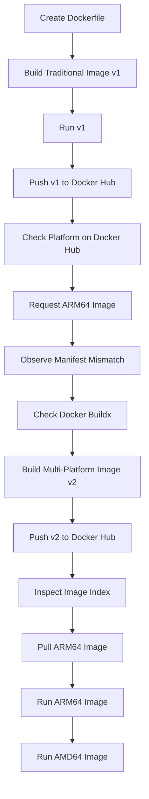

# Docker Multi-Architecture Images Using Buildx and BuildKit

## 1. Project Overview

In this practical, I learned how to build and publish Docker images for multiple CPU architectures using Docker Buildx and BuildKit.

Normally, when we build a Docker image on an AMD64 machine, the image is created for that architecture. If we try to run the same image on an ARM64 machine, we may face a platform compatibility issue.

To solve this problem, Docker provides multi-platform builds.

Using Docker Buildx, we can build images for multiple architectures using a single Dockerfile and publish them under the same image tag.

In this practical, I created two versions of a Docker image:

- **v1:** Traditional single-platform Docker image.
- **v2:** Multi-platform Docker image supporting AMD64 and ARM64.

I also verified both architectures using Docker Hub and Docker commands.

## 2. Project Objectives

- Understand the difference between single-platform and multi-platform images.
- Create a traditional Docker image.
- Push the image to Docker Hub.
- Understand the architecture compatibility problem.
- Learn about Docker Buildx and BuildKit.
- Build images for AMD64 and ARM64 architectures.
- Push multi-platform images using a single image tag.
- Verify and run images for both architectures.

## 3. Environment and Tools

| Component | Configuration |
|---|---|
| Host Operating System | Windows |
| Terminal | Windows PowerShell |
| Container Platform | Docker Desktop |
| Docker Engine | 29.9.2 |
| Docker Buildx | 0.38.1 |
| BuildKit | v0.34.0 |
| Container OS | Linux |
| Host Architecture | AMD64 (x86_64) |
| Target Architectures | AMD64 and ARM64 |
| Image Registry | Docker Hub |

**Docker Hub Repository:** `yuvi2102/multi-arch-demo`

**Repository URL:** https://hub.docker.com/r/yuvi2102/multi-arch-demo

## 4. Understanding Important Concepts

### 4.1 What is CPU Architecture?

CPU architecture defines how a processor executes instructions.

Some commonly used architectures are:

| Architecture | Description |
|---|---|
| AMD64 (x86_64) | Commonly used in Intel and AMD 64-bit processors |
| ARM64 (AArch64) | Used in Apple Silicon and AWS Graviton |
| IBM Z | Used in IBM mainframe systems |
| PPC64LE | Used in IBM Power systems |

AMD64 and ARM64 are different CPU architectures.

An image built for one architecture may not work natively on another architecture because the image can contain architecture-specific binaries and dependencies.

### 4.2 What is Docker BuildKit?

BuildKit is the modern build engine used by Docker.

It provides features such as:

- Build caching
- Parallel builds
- Improved build performance
- Multi-platform builds

### 4.3 What is Docker Buildx?

Docker Buildx is a Docker CLI plugin that provides advanced image-building capabilities using BuildKit.

It allows us to build Docker images for multiple architectures using a single command.

### 4.4 What is a Multi-Platform Image?

A multi-platform image supports multiple CPU architectures under a single image tag.

For example:

```text
yuvi2102/multi-arch-demo:v2
                  |
              Image Index
                  |
          -------------------
          |                 |
        AMD64              ARM64
          |                 |
       AMD Image         ARM Image
```

Docker stores an image index that contains references to different platform-specific images.

When someone pulls the image, Docker selects the appropriate platform-specific image based on the requested platform and the machine's architecture.

## 5. Practical Implementation

### Step 1: Verify Docker Installation

First, I checked whether Docker was installed on my Windows machine.

```powershell
docker --version
```

This command displays the installed Docker version.

Next, I checked Docker Engine information.

```powershell
docker info
```

Important details to verify:

- Server Version
- Operating System
- OSType
- Architecture
- CPUs
- Total Memory

Since I was using Docker Desktop on Windows, the output showed Linux as the container operating system.

Docker Desktop uses WSL2 to run Linux containers.

### Step 2: Check the Docker Architecture

I checked the architecture used by my Docker Engine.

```powershell
docker info --format '{{.Architecture}}'
```

Output:

```text
x86_64
```

This means my Docker Engine was running on AMD64 architecture.

### Step 3: Verify Docker Buildx

I checked whether Docker Buildx was installed.

```powershell
docker buildx version
```

This displays the installed Buildx version.

Next, I checked the available builders.

```powershell
docker buildx ls
```

My Docker Desktop already had two builders:

- default
- desktop-linux

Both were running with the Docker driver.

The output also showed the supported platforms, including:

```text
linux/amd64
linux/arm64
linux/arm
linux/ppc64le
```

This confirmed that my existing Docker Desktop builder supported both AMD64 and ARM64.

**Note:** Docker Desktop already provides BuildKit and Buildx, so I did not need to install or create another builder.

### Step 4: Login to Docker Hub

Before pushing images, I authenticated with Docker Hub.

```powershell
docker login
```

I completed the browser-based authentication.

Expected output:

```text
Login Succeeded
```

This allowed me to push images to my Docker Hub repository.

### Step 5: Create the Project Directory

I created a directory for this practical.

```powershell
mkdir multi-arch-demo
cd multi-arch-demo
```

To verify the current directory:

```powershell
pwd
```

To check the files:

```powershell
dir
```

### Step 6: Create the Dockerfile

I created a file named `Dockerfile` using Notepad.

```powershell
notepad Dockerfile
```

I added the following content:

```dockerfile
FROM ubuntu

CMD ["echo", "I am learning Multi-Arch Images"]
```

**Explanation:**

| Instruction | Description |
|---|---|
| FROM ubuntu | Uses Ubuntu as the base image |
| CMD | Specifies the default command when the container starts |
| echo | Prints a message in the terminal |

I saved the file as `Dockerfile` without the `.txt` extension.

To verify the file:

```powershell
dir
```

The directory should contain:

```text
Dockerfile
```

### Step 7: Build a Traditional Docker Image (v1)

First, I created a normal Docker image using the traditional Docker build command.

```powershell
docker build -t yuvi2102/multi-arch-demo:v1 .
```

**Command explanation:**

| Option | Description |
|---|---|
| docker build | Builds a Docker image |
| -t | Assigns a name and tag |
| yuvi2102 | Docker Hub username |
| multi-arch-demo | Repository name |
| v1 | Image version |
| . | Current directory containing the Dockerfile |

After the build completed, I verified the image.

```powershell
docker images
```

This command lists the locally available Docker images.

### Step 8: Run the Traditional Image

I executed the image using:

```powershell
docker run yuvi2102/multi-arch-demo:v1
```

Output:

```text
I am learning Multi-Arch Images
```

This confirmed that the Docker image was working on my machine.

### Step 9: Push v1 to Docker Hub

After verifying the image, I pushed it to Docker Hub.

```powershell
docker push yuvi2102/multi-arch-demo:v1
```

I opened my Docker Hub repository and checked the Tags section.

The v1 tag was available with the following platform:

```text
linux/amd64
```

This confirmed that my traditional image was available for AMD64 architecture only.

### Step 10: Reproduce the Architecture Compatibility Problem

Now I wanted to understand what happens when someone tries to pull an AMD64 image as an ARM64 image.

I executed:

```powershell
docker pull --platform linux/arm64 yuvi2102/multi-arch-demo:v1
```

Output:

```text
no matching manifest for linux/arm64
in the manifest list entries:
no match for platform in manifest
```

**Why did this happen?**

Our v1 image was built for AMD64 architecture.

When I explicitly requested ARM64, Docker checked the available image manifests but could not find an ARM64 image.

Therefore, the pull operation failed.

This demonstrated the architecture compatibility problem that we wanted to solve.

## 6. Building a Multi-Platform Image Using Buildx

Now I used Docker Buildx to build an image for both AMD64 and ARM64 architectures.

### Step 11: Check the Available Builders Again

Before building, I checked the available builders.

```powershell
docker buildx ls
```

I confirmed that the `desktop-linux` builder was running and supported:

- linux/amd64
- linux/arm64

Since both platforms were already supported, I continued with the existing builder.

### Step 12: Build and Push the Multi-Platform Image (v2)

I used the following command:

```powershell
docker buildx build --platform linux/amd64,linux/arm64 -t yuvi2102/multi-arch-demo:v2 --push .
```

**Command explanation:**

| Option | Description |
|---|---|
| docker buildx build | Builds an image using Docker Buildx |
| --platform | Specifies the target platforms |
| linux/amd64 | Builds for AMD64 architecture |
| linux/arm64 | Builds for ARM64 architecture |
| -t | Assigns the image name and tag |
| v2 | New image version |
| --push | Pushes the resulting multi-platform image to Docker Hub |
| . | Uses the current directory as the build context |

With this command, Buildx used BuildKit to build the image for both architectures.

It then pushed the platform-specific images and the image index to Docker Hub.

**Important:** I used the same Dockerfile for both architectures. I did not need to create separate Dockerfiles.

### Step 13: Verify the Image on Docker Hub

After the build and push completed, I opened my Docker Hub repository.

Repository:

https://hub.docker.com/r/yuvi2102/multi-arch-demo/tags

Under the v2 tag, I verified that both architectures were available.

| Tag | OS / Architecture |
|---|---|
| v2 | linux/amd64 |
| v2 | linux/arm64 |

This confirmed that the multi-platform image was successfully published.

### Step 14: Inspect the Multi-Platform Image

I used the following command to inspect the image index.

```powershell
docker buildx imagetools inspect yuvi2102/multi-arch-demo:v2
```

The output showed:

```text
MediaType: application/vnd.oci.image.index.v1+json

Platform: linux/amd64

Platform: linux/arm64
```

**What did I learn?**

- OCI image index contains references to multiple platform-specific images.
- One manifest points to the AMD64 image.
- Another manifest points to the ARM64 image.

I also noticed `unknown/unknown` entries in the output. These were associated with build attestations and were not additional CPU architectures.

### Step 15: Pull the ARM64 Image

Earlier, pulling the ARM64 image using v1 failed.

Now I tried the same operation using v2.

```powershell
docker pull --platform linux/arm64 yuvi2102/multi-arch-demo:v2
```

The image was successfully pulled.

This confirmed that the v2 image contained an ARM64 platform-specific image.

### Step 16: Run the ARM64 Image

I executed:

```powershell
docker run --platform linux/arm64 yuvi2102/multi-arch-demo:v2
```

Output:

```text
I am learning Multi-Arch Images
```

The ARM64 image executed successfully on my AMD64 machine through emulation provided by Docker Desktop.

### Step 17: Run the AMD64 Image

Finally, I tested the AMD64 image explicitly.

```powershell
docker run --platform linux/amd64 yuvi2102/multi-arch-demo:v2
```

Output:

```text
I am learning Multi-Arch Images
```

Both AMD64 and ARM64 executions were successful.

**Note:** These tests were performed on an AMD64 machine using platform emulation. Testing on actual ARM64 hardware would provide additional confirmation on a native ARM environment.

## 7. Final Comparison: v1 vs v2

| Feature | v1 | v2 |
|---|---|---|
| Build method | Docker Build | Docker Buildx |
| AMD64 support | Yes | Yes |
| ARM64 support | No | Yes |
| Same Dockerfile | Yes | Yes |
| Same image tag for multiple architectures | No | Yes |
| ARM64 pull | Failed | Successful |
| ARM64 execution through emulation | Not available | Successful |
| Docker Hub | Published | Published |

## 8. Complete Project Workflow



## 9. Important Commands Reference

These are the main commands I used throughout this practical.

### Docker Environment Checks

```powershell
docker --version
docker info
docker info --format '{{.Architecture}}'
docker buildx version
docker buildx ls
docker login
```

### Project Setup

```powershell
mkdir multi-arch-demo
cd multi-arch-demo
notepad Dockerfile
dir
pwd
```

### Traditional Image Build

```powershell
docker build -t yuvi2102/multi-arch-demo:v1 .
```

### Image Verification and Execution

```powershell
docker images
docker run yuvi2102/multi-arch-demo:v1
```

### Push Traditional Image

```powershell
docker push yuvi2102/multi-arch-demo:v1
```

### Multi-Platform Image Build and Push

```powershell
docker buildx build --platform linux/amd64,linux/arm64 -t yuvi2102/multi-arch-demo:v2 --push .
```

### Inspect Multi-Platform Image

```powershell
docker buildx imagetools inspect yuvi2102/multi-arch-demo:v2
```

### Pull Images for Specific Platforms

```powershell
docker pull --platform linux/arm64 yuvi2102/multi-arch-demo:v2
```

### Run Images for Specific Platforms

```powershell
docker run --platform linux/amd64 yuvi2102/multi-arch-demo:v2

docker run --platform linux/arm64 yuvi2102/multi-arch-demo:v2
```

## 10. Important Learnings

Through this practical, I learned:

1. Docker helps maintain consistent application environments.
2. Docker images can contain architecture-specific binaries and dependencies.
3. AMD64 and ARM64 are different CPU architectures.
4. A traditional image built for one architecture might not work on another architecture.
5. Docker Buildx allows us to build images for multiple platforms.
6. BuildKit is the build engine used by Buildx.
7. A multi-platform image uses an image index containing references to platform-specific images.
8. Multiple architecture-specific images can be published under the same image tag.
9. Docker selects the appropriate platform-specific image when pulling an image.
10. We can use emulation to test different architectures without owning separate physical machines.

## 11. Final Result

I successfully created and published two Docker image versions to Docker Hub.

**v1 – Traditional Docker Image**

- Built using `docker build`.
- Supports AMD64 architecture.
- ARM64 pull request failed because the required platform manifest was unavailable.

**v2 – Multi-Platform Docker Image**

- Built using Docker Buildx and BuildKit.
- Supports both AMD64 and ARM64 architectures.
- Published under a single image tag.
- Successfully pulled and executed both architectures using platform emulation.

### Docker Hub Repository

https://hub.docker.com/r/yuvi2102/multi-arch-demo

### Conclusion

This practical helped me understand how Docker multi-platform builds work and why they are useful in real-world environments.

Instead of maintaining separate image tags and build commands for different architectures, we can use Docker Buildx to build and publish multiple platform-specific images under a single tag.

This makes Docker image distribution easier across different hardware architectures and simplifies the image-building process in CI/CD pipelines.
