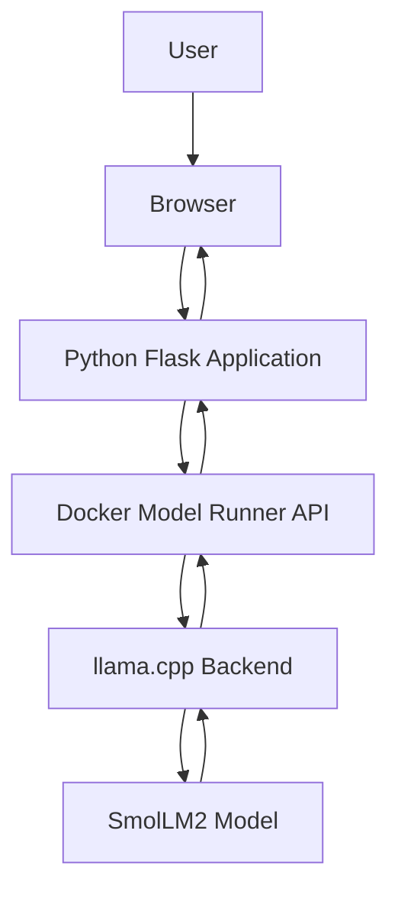

# Project 13: Understanding Docker Model Runner

## 1. What is Docker Model Runner?

Docker Model Runner is a tool that allows us to download and run AI models locally using Docker.

Normally, we use online AI services to interact with AI models. But with Docker Model Runner, we can run supported AI models on our own machine without sending every prompt to an external AI service.

**Example:**

We downloaded the SmolLM2 model and ran it locally using Docker Model Runner. We could ask questions and receive answers directly through PowerShell.

## 2. What is an AI Model?

An AI model is a program trained using large amounts of data. It can understand information and generate responses based on what it has learned.

For example, an AI language model can:

- Answer questions
- Explain technical concepts
- Generate text
- Summarize information
- Help with coding

**Example:** SmolLM2 is a small language model that can understand prompts and generate text responses.

## 3. What is a Local AI Model?

A local AI model is an AI model that runs on our own computer instead of depending on a remote AI service.

**Example:**

When I run SmolLM2 using Docker Model Runner, the model runs locally on my machine.

Some benefits of running models locally are:

- We can experiment with AI models on our own system.
- We have more control over the model environment.
- We can reduce the need to send prompts to external AI services.
- We can learn how AI applications work.

The model still needs enough system resources, such as RAM and storage, to run properly.

## 4. What is SmolLM2?

SmolLM2 is a small language model developed by Hugging Face.

It can perform basic language tasks such as answering questions, generating text and following instructions.

In this project, I used SmolLM2 as the AI model for my local AI assistant.

**Model identifier:**

`ai/smollm2`

## 5. What is Docker Hub AI?

Docker Hub AI is a collection of AI models available through Docker Hub.

We can browse different model repositories and find models that can be used with Docker Model Runner.

For example, I selected SmolLM2 from the Docker AI model catalog.

Link: https://hub.docker.com/u/ai

**How it works:**

1. Open the Docker Hub AI catalog.
2. Search for an AI model.
3. Open the model repository.
4. Check its available tags and details.
5. Select a compatible model and use its identifier to download it.

Not every model is automatically compatible with every setup. We should check its requirements before using it.

## 6. What is an LLM?

LLM stands for Large Language Model.

It is an AI model trained on a large amount of text data. It can understand questions and generate human-like text responses.

Examples of language models include:

- Llama
- SmolLM2
- Mistral
- Gemma

In this project, I used SmolLM2 to generate responses for the AI assistant.

## 7. What is llama.cpp?

llama.cpp is an inference engine used to run supported AI language models.

An inference engine helps load a trained model and generate responses when we provide prompts.

Docker Model Runner can use llama.cpp as its backend to run supported models.

**Example:**

In my practical, Docker Model Runner automatically installed the llama.cpp backend when I first ran SmolLM2.

## 8. What is an Inference?

Inference is the process of using a trained AI model to generate an answer or prediction from new input.

**Example:**

- Input: What is Docker?
- Model: SmolLM2
- Output: An explanation of Docker.

Here, the model processes the input and generates a response. This process is called inference.

## 9. What is a Prompt?

A prompt is the input or instruction we give to an AI model.

The model uses this input to understand what we are asking and generate a suitable response.

**Example:**

```text
Explain the difference between Docker and Kubernetes.
```

This is a prompt given to SmolLM2.

## 10. What is an API in Docker Model Runner?

An API allows applications to communicate with another service.

Docker Model Runner provides an API that an application can use to send prompts to an AI model and receive responses.

In simple words:

- Our application sends a question.
- Docker Model Runner receives the request.
- The AI model processes the question.
- The generated response is returned to the application.

Docker Model Runner supports APIs that are compatible with OpenAI-style and Ollama-style interfaces.

## 11. What is Docker Compose Model Integration?

Docker Compose allows us to define and run multiple services using a YAML file.

Docker Compose also supports model integration. It allows an application service to connect with an AI model through a model configuration.

In my project, I used two files:

**models.yml**

This file defines the AI model that should be used.

```yaml
models:
  llama:
    model: ai/smollm2
    context_size: 2048
```

**docker-compose.yml**

This file defines the Python application service and connects it to the model.

```yaml
models:
  - llama
```

Here, `llama` is the model reference name used by Docker Compose. The actual model is `ai/smollm2`.

## 12. How Does the Local AI Assistant Work?

The Python application acts as the interface between the user and the AI model.

The complete flow is:

1. The user opens the AI assistant website.
2. The user enters a question.
3. The Python Flask application receives the question.
4. The application sends the request to Docker Model Runner.
5. Docker Model Runner uses the llama.cpp backend to run SmolLM2.
6. The model generates a response.
7. The response is sent back to the Python application.
8. The answer is displayed on the website.

### Architecture



## 13. Benefits of Docker Model Runner

- **Local execution:** Run supported AI models on your own machine.
- **Easy setup:** Use Docker commands to download and run models.
- **Model management:** Manage downloaded models using Docker CLI.
- **Application integration:** Connect AI models with applications using APIs.
- **Development and testing:** Experiment with AI applications in a local environment.

## 14. Important Commands

| Command | Purpose |
|---|---|
| `docker model --help` | View available model commands |
| `docker model status` | Check Model Runner status |
| `docker model pull ai/smollm2` | Download SmolLM2 |
| `docker model list` | View downloaded models |
| `docker model show ai/smollm2` | View model details |
| `docker model run ai/smollm2` | Run the model |
| `docker model ps` | View running models |

## 15. What I Learned

Through this project, I learned how Docker Model Runner helps us run AI models locally. I understood how to download and manage models, connect them with a Python application and build a simple AI assistant using Docker Compose.

I also learned how an application communicates with an AI model through an API and how the model generates responses using an inference engine.

**Official References:**

- [Docker Model Runner Documentation](https://docs.docker.com/ai/model-runner/)
- [Docker Compose Models Documentation](https://docs.docker.com/ai/compose/models-and-compose/)
- [Docker Hub AI Models](https://hub.docker.com/u/ai)
- [Hello-GenAI GitHub Repository](https://github.com/docker/hello-genai)
