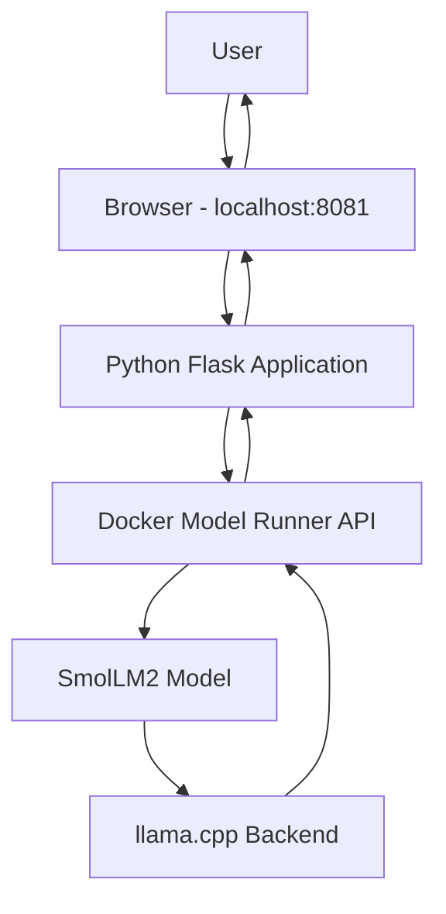

# Project 13: Building a Local AI Assistant Using Docker Model Runner and Python

## Project Overview

In this project, we use Docker Model Runner to download and run an AI model locally. We then integrate the model with a Python Flask application and build a web-based AI assistant.

The application allows users to ask questions through a browser and receive AI-generated responses using a locally running language model.

**Project Objective:**
- Download and run an AI model locally.
- Interact with the model through the terminal.
- Understand how Docker Model Runner works with Docker.
- Integrate a local AI model with a Python application.
- Build and run the Python application using Docker Compose.
- Access the AI assistant through a web browser.

## 1. Technologies and Tools Used

| Technology | Purpose |
|---|---|
| Docker Desktop | Container management and Model Runner |
| Docker Model Runner | Downloading and serving local AI models |
| SmolLM2 | Local language model |
| llama.cpp | Backend used to execute the language model |
| Python | Application development |
| Flask | Python web framework |
| Docker Compose | Running the application |
| Git | Cloning the project repository |
| PowerShell | Executing commands |
| HTML, CSS, JavaScript | Chatbot website interface |

## 2. Prerequisites

Before starting the practical, make sure the following tools are installed:

- Windows 10/11
- Docker Desktop
- Git
- Docker Compose
- PowerShell
- Internet connection

Verify the installations:

```powershell
docker --version
git --version
docker compose version
docker model --help
```

## 3. Enable Docker Model Runner

Open Docker Desktop and make sure Docker Engine is running.

Check the Model Runner status:

```powershell
docker model status
```

If Docker Model Runner is not running, enable it:

```powershell
docker desktop enable model-runner
```

Verify again:

```powershell
docker model status
```

Expected result:

```text
Docker Model Runner is running
```

The backend components may initially show as not installed. The required inference backend can be installed when you first run a model.

## 4. Download an AI Model

For this project, we use SmolLM2 because it is a lightweight language model suitable for local experimentation.

Download the model:

```powershell
docker model pull ai/smollm2
```

Docker Model Runner downloads the model from the model registry and stores it locally.

Verify the downloaded model:

```powershell
docker model list
```

Check the model details:

```powershell
docker model show ai/smollm2
```

## 5. Run the AI Model Through the Terminal

Start the model in interactive chat mode:

```powershell
docker model run ai/smollm2
```

The first execution may install the required inference backend. In our practical, Docker Model Runner installed the `llama.cpp` backend automatically.

Once the model starts, ask questions:

```text
What is Docker?
```

```text
What is Kubernetes?
```

```text
Explain the difference between Docker and Kubernetes.
```

The model generates responses directly in PowerShell.

To exit the interactive chat, use:

```text
Ctrl + C
```

You can also provide a single prompt without entering interactive mode:

```powershell
docker model run ai/smollm2 "What is Docker?"
```

Verify running models:

```powershell
docker model ps
```

## 6. Clone the Python AI Assistant Project

We use Docker's official Hello-GenAI repository.

Repository:

https://github.com/docker/hello-genai

Navigate to your working directory:

```powershell
cd C:\Users\Yuvraj\multi-arc-demo
```

Clone the repository:

```powershell
git clone https://github.com/docker/hello-genai.git
```

Enter the project directory:

```powershell
cd hello-genai
```

List the files:

```powershell
dir
```

The repository contains examples for multiple programming languages.

```text
hello-genai/
│
├── .github/
├── go-genai/
├── node-genai/
├── py-genai/
├── rust-genai/
│
├── .gitignore
├── .npmrc
├── docker-compose.yml
├── Dockerfile
├── models.yml
└── README.md
```

For this practical, we use the Python application.

## 7. Explore the Python Application

Navigate to the Python project:

```powershell
cd py-genai
```

List the files:

```powershell
dir
```

Project structure:

```text
py-genai/
│
├── static/
├── templates/
├── .dockerignore
├── app.py
├── docker-compose.yml
├── Dockerfile
├── README.md
├── requirements.lock.txt
├── requirements.txt
├── run_app.sh
└── test_static.py
```

Important files:

| File / Folder | Purpose |
|---|---|
| `app.py` | Main Python application |
| `templates/` | HTML templates for the chatbot |
| `static/` | CSS, JavaScript and static assets |
| `Dockerfile` | Instructions for building the Python image |
| `docker-compose.yml` | Defines the Python application service |
| `requirements.txt` | Python dependencies |
| `README.md` | Project documentation |
| `run_app.sh` | Application startup script |

Read the Python application instructions:

```powershell
Get-Content README.md
```

## 8. Understand the Docker Compose Configuration

Read the Compose file:

```powershell
Get-Content docker-compose.yml
```

The configuration contains the following important sections:

### Include

```yaml
include:
  - path: ../models.yml
```

This imports the model configuration from the parent project directory.

### Python Service

```yaml
services:
  python-genai:
    build:
      context: .
      dockerfile: Dockerfile
```

This defines a Python service and tells Docker to build the application image using the Dockerfile in the current directory.

### Port Mapping

```yaml
ports:
  - "8081:8080"
```

- `8081` is the Windows host port.
- `8080` is the container port.

We access the application through port 8081 in our browser.

### Environment Variables

```yaml
environment:
  - PORT=8080
  - LOG_LEVEL=INFO
```

These variables configure the application port and logging level.

### Model Connection

```yaml
models:
  - llama
```

This connects the Python service to the model configuration named `llama`.

### Health Check

```yaml
healthcheck:
  test: ["CMD", "curl", "-f", "http://localhost:8080/health"]
  interval: 30s
  timeout: 10s
  retries: 3
  start_period: 10s
```

Docker periodically checks the health endpoint to verify that the Python application is responding.

## 9. Configure the AI Model

Move to the parent project directory:

```powershell
cd ..
```

You should now be inside:

```text
C:\Users\Yuvraj\multi-arc-demo\hello-genai
```

Read the model configuration:

```powershell
Get-Content models.yml
```

The original configuration used Llama 3.2:

```yaml
models:
  llama:
    model: ai/llama3.2:1B-Q8_0
    context_size: 2048
```

Since we already downloaded SmolLM2, we updated the configuration to use that model.

Open the file:

```powershell
notepad models.yml
```

Replace the existing content with:

```yaml
models:
  llama:
    model: ai/smollm2
    context_size: 2048
```

Save the file and close Notepad.

Verify the changes:

```powershell
Get-Content models.yml
```

**Important:** We kept the configuration name `llama` because the Python service references that name in its Docker Compose configuration. Only the actual model was changed to `ai/smollm2`.

## 10. Build and Start the Python Application

Navigate back to the Python application directory:

```powershell
cd py-genai
```

Verify your current location:

```powershell
pwd
```

Expected directory:

```text
C:\Users\Yuvraj\multi-arc-demo\hello-genai\py-genai
```

Start the application:

```powershell
docker compose up --build
```

### What happens during execution?

1. Docker Compose reads the Python `docker-compose.yml` file.
2. It imports the model configuration from `../models.yml`.
3. Docker builds the Python application image using the Dockerfile.
4. Docker creates the required network.
5. Docker creates the Python application container.
6. Docker Model Runner provides access to the configured SmolLM2 model.
7. The Python Flask application starts inside the container.
8. The application becomes accessible through port 8081 on Windows.

The first build may take some time because Docker needs to download dependencies and build the application image.

### Expected Application Logs

Look for logs similar to:

```text
Server starting on http://localhost:8080

Using LLM endpoint:
http://model-runner.docker.internal/v1/chat/completions

Using model: ai/smollm2

Running on http://127.0.0.1:8080
```

You may also see health check requests:

```text
GET /health HTTP/1.1 200
```

A `200` response indicates that the health endpoint is responding successfully.

**Important:** Keep this PowerShell window open while the application is running.

## 11. Access the AI Assistant Website

Open your browser and visit:

http://localhost:8081

You should see the Hello-GenAI in Python interface.

The website displays:

- AI Assistant heading
- Chat interface
- Message input field
- Send button
- AI-generated responses

Try asking these questions:

```text
What is Docker?
```

```text
What is Kubernetes?
```

```text
What is the difference between AWS EC2 and S3?
```

The Python application sends your questions to Docker Model Runner, which uses SmolLM2 to generate responses.

The generated responses are displayed on the website.

## 12. Application Architecture

The following diagram shows how the different components communicate.



### Request and Response Flow

1. The user enters a question in the browser.
2. The frontend sends the question to the Python Flask application.
3. Flask receives the request through the `/api/chat` endpoint.
4. Python communicates with Docker Model Runner.
5. Docker Model Runner passes the request to SmolLM2.
6. SmolLM2 generates the response using the inference backend.
7. The response travels back to the Python application.
8. The browser displays the generated answer.

## 13. Verify the Running Application

Open a second PowerShell window without closing the first one.

Check the downloaded models:

```powershell
docker model list
```

Check running models:

```powershell
docker model ps
```

Navigate to the Python project directory:

```powershell
cd C:\Users\Yuvraj\multi-arc-demo\hello-genai\py-genai
```

Check the Compose services:

```powershell
docker compose ps
```

Check application logs:

```powershell
docker compose logs -f python-genai
```

Verify the application in your browser:

```text
http://localhost:8081
```

## 14. Stop the Application

Return to the PowerShell window where Docker Compose is running.

Press:

```text
Ctrl + C
```

This stops the foreground application.

Then execute:

```powershell
docker compose down
```

This stops and removes the Compose-managed containers and network.

The downloaded AI model remains available locally.

Verify:

```powershell
docker model list
```

## 15. How to Run This Project Again

If you return to this project after several days or months, follow these steps.

### Step 1: Start Docker Desktop

Open Docker Desktop and wait until Docker Engine is running.

### Step 2: Check Docker Model Runner

```powershell
docker model status
```

If it is not running:

```powershell
docker desktop enable model-runner
```

### Step 3: Verify the model

```powershell
docker model list
```

If SmolLM2 is missing, download it again:

```powershell
docker model pull ai/smollm2
```

### Step 4: Navigate to the Python application

```powershell
cd C:\Users\Yuvraj\multi-arc-demo\hello-genai\py-genai
```

### Step 5: Start the application

```powershell
docker compose up --build
```

### Step 6: Open the website

Visit:

```text
http://localhost:8081
```

Your local AI assistant is ready to use.

## 16. Troubleshooting

| Problem | Possible Solution |
|---|---|
| Docker command not recognized | Install Docker Desktop and verify its PATH configuration. |
| Docker Model Runner is not running | Execute `docker desktop enable model-runner`. |
| Model is not available locally | Execute `docker model pull ai/smollm2`. |
| Model Runner backend is missing | Run the model using `docker model run ai/smollm2` and allow the required backend to install. |
| Model download fails | Check your internet connection and try pulling the model again. |
| Docker Compose build fails | Check the Dockerfile, dependencies and build logs. |
| Port 8081 is already in use | Stop the application using that port or change the host port mapping. |
| Website is not opening | Check `docker compose ps` and inspect application logs. |
| AI responses are not generated | Verify Model Runner status, model configuration and application logs. |
| Python container cannot connect to Model Runner | Check the Compose model configuration and Docker Model Runner availability. |

## 17. Important Commands Reference

### Docker Model Runner Commands

```powershell
# Check Model Runner status
docker model status

# Enable Model Runner
docker desktop enable model-runner

# Download an AI model
docker model pull ai/smollm2

# List downloaded models
docker model list

# Run an AI model
docker model run ai/smollm2

# Run a model with a single prompt
docker model run ai/smollm2 "What is Docker?"

# Show running models
docker model ps

# Inspect model information
docker model show ai/smollm2

# Remove a downloaded model
docker model rm ai/smollm2
```

### Docker Compose Commands

```powershell
# Build and start the application
docker compose up --build

# Start in detached mode
docker compose up -d --build

# List application containers
docker compose ps

# View application logs
docker compose logs -f python-genai

# Stop and remove containers
docker compose down

# Rebuild the application
docker compose build --no-cache
```

## 18. Project Completion Checklist

- [x] Verified Docker Desktop installation.
- [x] Enabled Docker Model Runner.
- [x] Downloaded SmolLM2.
- [x] Verified the downloaded model.
- [x] Installed the llama.cpp inference backend.
- [x] Ran SmolLM2 through PowerShell.
- [x] Tested questions through the terminal.
- [x] Cloned the official Hello-GenAI repository.
- [x] Explored the Python application structure.
- [x] Inspected Docker Compose configuration.
- [x] Updated `models.yml` to use SmolLM2.
- [x] Built the Python Docker image.
- [x] Started the Python application using Docker Compose.
- [x] Opened the chatbot at `localhost:8081`.
- [x] Tested AI-generated responses through the website.

## 19. Final Outcome

Successfully built and executed a local AI assistant using Docker Model Runner and Python.

Downloaded and ran SmolLM2 locally, integrated it with a Python Flask application, containerized the application using Docker and started it using Docker Compose.

The final application allows users to interact with a locally running AI model through a web-based chatbot without depending on a hosted LLM API.

**Project Repository:** https://github.com/docker/hello-genai

**Application URL:** http://localhost:8081

**Documentation:** My-Devops-Cloud-Journey / DevOps-Labs-and-Projects

---

**Note:** This document records the practical workflow performed on Windows using Docker Desktop and PowerShell. Model availability, Docker Desktop requirements and repository files may change over time. Check the official documentation if you encounter version-related differences.
