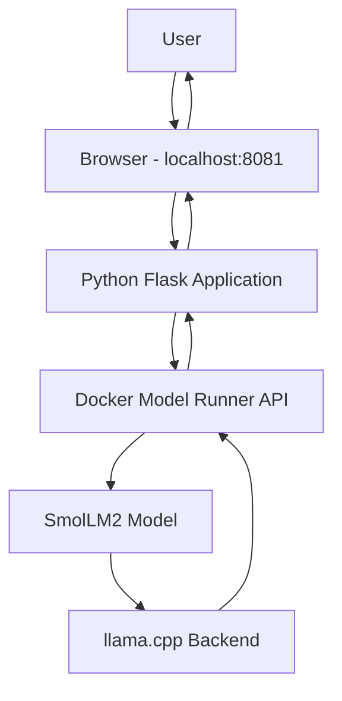

# Project 13: Building a Local AI Assistant Using Docker Model Runner and Python

## Project Overview

In this project, I explored Docker Model Runner and learned how to run AI models locally using Docker.

I started by enabling Docker Model Runner, exploring available AI models on Docker Hub and downloading SmolLM2. After that, I interacted with the model through PowerShell.

I then cloned Docker's Hello-GenAI repository, explored the Python application and connected it to my locally running AI model. Finally, I built the Python application using Docker and started it with Docker Compose.

The final result was a working AI assistant website where I could ask questions and receive AI-generated responses using a local AI model.

### Project Objectives

- Explore and download AI models from Docker Hub.
- Enable and configure Docker Model Runner.
- Run an AI model locally.
- Interact with the model through PowerShell.
- Understand how Docker Model Runner connects with Python.
- Build a Python-based AI assistant.
- Containerize the application using Docker.
- Run the application using Docker Compose.
- Access and test the AI assistant through a browser.

## 1. Technologies and Tools Used

| Technology | Purpose |
|---|---|
| Docker Desktop | Container management and Docker Model Runner |
| Docker Model Runner | Downloading and running AI models locally |
| Docker Hub | Discovering and downloading AI models |
| SmolLM2 | Local language model |
| llama.cpp | Backend used to execute the language model |
| Python | Application development |
| Flask | Python web framework |
| Docker | Containerizing the application |
| Docker Compose | Building and running the application |
| Git | Cloning the project repository |
| PowerShell | Executing commands |
| HTML, CSS, JavaScript | Chatbot website interface |

## 2. Prerequisites

Before starting the practical, make sure the following tools are installed:

- Windows 10/11
- Docker Desktop
- Git
- Docker Compose
- PowerShell
- Internet connection

Open Docker Desktop and make sure Docker Engine is running.

Verify the installations using PowerShell.

**Check Docker:**

```powershell
docker --version
```

**Check Git:**

```powershell
git --version
```

**Check Docker Compose:**

```powershell
docker compose version
```

**Check Docker Model Runner commands:**

```powershell
docker model --help
```

If all the commands return their version or help information, we can proceed.

## 3. Enable Docker Model Runner

First, check whether Docker Model Runner is running.

```powershell
docker model status
```

If it displays that Docker Model Runner is not running, enable it using:

```powershell
docker desktop enable model-runner
```

Now check the status again:

```powershell
docker model status
```

Expected output:

```text
Docker Model Runner is running
```

The backend status may initially show components such as `llama.cpp` and `diffusers` as not installed.

This is normal. The required inference backend can be installed when we first run a compatible model.

## 4. Explore Available AI Models on Docker Hub

Before downloading an AI model, I first explored the available models on Docker Hub.

Docker Hub provides a catalog where we can discover different AI models, check their available versions and select the models we want to run locally.

**Docker Hub AI Models:**

https://hub.docker.com/u/ai

### Steps to Find and Select a Model

1. Open the Docker Hub AI models page.
2. Browse the available model repositories.
3. You can use the repository search option to find a particular model.
4. Open the model repository you are interested in.
5. Check the available tags to see which versions are provided.
6. Copy the model identifier and the tag you want to use.

For example, we can explore models such as:

- SmolLM2
- Llama
- Gemma
- Other available language models

### Example: Selecting SmolLM2

For this practical, I selected SmolLM2 because it is a lightweight language model suitable for local experimentation.

The model identifier used in our practical was:

```text
ai/smollm2
```

**Important:** The model repository page provides the model name and available tags. Use the exact model identifier and tag shown on Docker Hub when downloading a particular version.

### Download the Selected Model

Once we have selected the model, open PowerShell and execute:

```powershell
docker model pull ai/smollm2
```

Docker Model Runner downloads the selected model from the model registry and stores it locally.

The first download may take some time depending on the model size and internet speed.

### Verify the Downloaded Model

```powershell
docker model list
```

This displays the models downloaded to the local environment.

To view information about a particular model:

```powershell
docker model show ai/smollm2
```

In our practical, SmolLM2 was downloaded successfully and appeared in the local model list.

**Note:** We can follow the same process to download other compatible models from Docker Hub. Just replace `ai/smollm2` with the model identifier and tag we selected.

## 5. Run the AI Model Through PowerShell

After downloading SmolLM2, I wanted to test whether the model was working correctly before connecting it to a Python application.

### Start the Model in Interactive Mode

Execute:

```powershell
docker model run ai/smollm2
```

The first execution may install the required inference backend.

In our practical, Docker Model Runner installed the `llama.cpp` backend automatically.

Once the model starts, we can ask questions directly through PowerShell.

**Example 1:**

```text
What is Docker?
```

**Example 2:**

```text
What is Kubernetes?
```

**Example 3:**

```text
Explain the difference between Docker and Kubernetes.
```

The model processes the questions and generates responses directly in the terminal.

### Run the Model with a Single Prompt

We can also provide a question directly without entering interactive chat mode.

```powershell
docker model run ai/smollm2 "What is Docker?"
```

### Exit Interactive Chat

To exit the interactive session, press:

```text
Ctrl + C
```

### Verify Running Models

```powershell
docker model ps
```

This displays the models currently loaded and running.

At this point, we have successfully downloaded SmolLM2 and interacted with it through PowerShell.

## 6. Clone the Hello-GenAI Project from GitHub

After testing the model through the terminal, the next step was to integrate it with a Python application.

For this, I used Docker's official Hello-GenAI repository.

**GitHub Repository:**

https://github.com/docker/hello-genai

This repository contains example GenAI applications built using different programming languages, including Python, Node.js, Go and Rust.

### Clone the Repository

First, navigate to your working directory.

```powershell
cd C:\Users\Yuvraj\multi-arc-demo
```

Clone the repository:

```powershell
git clone https://github.com/docker/hello-genai.git
```

Enter the project directory:

```powershell
cd hello-genai
```

List the files:

```powershell
dir
```

The repository contains the following structure:

```text
hello-genai/
│
├── .github/
├── go-genai/
├── node-genai/
├── py-genai/
├── rust-genai/
│
├── .gitignore
├── .npmrc
├── docker-compose.yml
├── Dockerfile
├── models.yml
└── README.md
```

For this practical, I focused on the Python application.

## 7. Explore the Python Application

Navigate to the Python application directory:

```powershell
cd py-genai
```

List the files:

```powershell
dir
```

The Python project structure looks like this:

```text
py-genai/
│
├── static/
├── templates/
├── .dockerignore
├── app.py
├── docker-compose.yml
├── Dockerfile
├── README.md
├── requirements.lock.txt
├── requirements.txt
├── run_app.sh
└── test_static.py
```

### Important Files and Folders

| File / Folder | Purpose |
|---|---|
| `app.py` | Main Python application logic |
| `templates/` | HTML templates used for the website |
| `static/` | CSS, JavaScript and other static files |
| `Dockerfile` | Instructions for building the Python image |
| `docker-compose.yml` | Defines the Python application service |
| `requirements.txt` | Python dependencies |
| `requirements.lock.txt` | Locked dependency versions |
| `README.md` | Project instructions |
| `run_app.sh` | Application startup script |
| `test_static.py` | Static file tests |

### Read the Project Documentation

Execute:

```powershell
Get-Content README.md
```

The README explains the application configuration, available API endpoints and different ways to run the application.

Some important API endpoints mentioned in the documentation are:

| Endpoint | Purpose |
|---|---|
| `GET /` | Opens the chatbot website |
| `POST /api/chat` | Sends a question to the AI model |
| `GET /health` | Checks application health |
| `GET /api/docs` | Displays API documentation |

## 8. Understand the Docker Compose Configuration

Before starting the application, I inspected the Docker Compose file.

Execute:

```powershell
Get-Content docker-compose.yml
```

The configuration contains the following sections.

### Include

```yaml
include:
  - path: ../models.yml
```

This imports the model configuration from the parent project directory.

### Python Service

```yaml
services:
  python-genai:
    build:
      context: .
      dockerfile: Dockerfile
```

This defines a service named `python-genai`.

Docker uses the current directory as the build context and the Dockerfile to build the Python application image.

### Port Mapping

```yaml
ports:
  - "8081:8080"
```

This maps the Windows host port to the port inside the Python container.

| Port | Purpose |
|---|---|
| 8081 | Windows host port |
| 8080 | Python container port |

We access the application through port `8081` in our browser.

### Environment Variables

```yaml
environment:
  - PORT=8080
  - LOG_LEVEL=INFO
```

These variables configure the application port and logging level.

### Model Connection

```yaml
models:
  - llama
```

This connects the Python service to the model configuration named `llama`.

### Health Check

```yaml
healthcheck:
  test: ["CMD", "curl", "-f", "http://localhost:8080/health"]
  interval: 30s
  timeout: 10s
  retries: 3
  start_period: 10s
```

Docker periodically checks the health endpoint to verify that the Python application is responding.

## 9. Configure the AI Model

Now we need to connect our downloaded SmolLM2 model to the Python application.

The `models.yml` file is located in the main `hello-genai` directory, not inside `py-genai`.

Move back to the parent directory:

```powershell
cd ..
```

Our current location should be:

```text
C:\Users\Yuvraj\multi-arc-demo\hello-genai
```

Read the model configuration:

```powershell
Get-Content models.yml
```

The original configuration was:

```yaml
models:
  llama:
    model: ai/llama3.2:1B-Q8_0
    context_size: 2048
```

This configuration points to Llama 3.2.

Since we already downloaded SmolLM2, we need to update the model configuration.

### Update models.yml

Open the file using Notepad:

```powershell
notepad models.yml
```

Replace the existing content with:

```yaml
models:
  llama:
    model: ai/smollm2
    context_size: 2048
```

Save the file and close Notepad.

Verify the changes:

```powershell
Get-Content models.yml
```

### Why did we keep the name llama?

In the Python application's Docker Compose configuration, the service references a model named `llama`.

```yaml
models:
  - llama
```

This is the Compose model reference, not the actual model repository name.

Therefore, we kept the name `llama` and changed only the model it points to.

Now the Python application is configured to use our downloaded SmolLM2 model.

## 10. Build and Start the Python Application

After updating the model configuration, navigate back to the Python application directory.

```powershell
cd py-genai
```

Verify the current location:

```powershell
pwd
```

Expected location:

```text
C:\Users\Yuvraj\multi-arc-demo\hello-genai\py-genai
```

Now build and start the application using Docker Compose:

```powershell
docker compose up --build
```

### What Happens During Execution?

1. Docker Compose reads the Python application's `docker-compose.yml`.
2. It imports the model configuration from the parent directory.
3. Docker builds the Python application image using the Dockerfile.
4. Docker creates the required network.
5. Docker creates the Python application container.
6. Docker Model Runner provides access to the configured SmolLM2 model.
7. The Python Flask application starts inside the container.
8. The application becomes accessible through port `8081` on Windows.

The first build may take a few minutes because Docker needs to download dependencies and build the application image.

### Verify the Application Logs

Look for output similar to:

```text
Server starting on http://localhost:8080

Using LLM endpoint:
http://model-runner.docker.internal/v1/chat/completions

Using model: ai/smollm2
```

You may also see Flask application logs:

```text
Serving Flask app 'app'

Running on http://127.0.0.1:8080
Running on http://172.19.0.2:8080
```

And health check responses:

```text
GET /health HTTP/1.1 200
```

A `200` response indicates that the health endpoint is responding successfully.

**Important:** Keep this PowerShell window open while the application is running.

## 11. Access the AI Assistant Website

Once the Python application has started successfully, open your browser.

Visit:

```text
http://localhost:8081
```

You should see the Hello-GenAI in Python interface.

The website contains:

- AI Assistant heading
- Chat interface
- Message input field
- Send button
- AI-generated responses

### Test the AI Assistant

Enter a few questions into the chatbot.

**Test 1:**

```text
What is Docker?
```

**Test 2:**

```text
What is Kubernetes?
```

**Test 3:**

```text
What is the difference between AWS EC2 and S3?
```

Click Send and wait for the responses.

The Python application sends your questions to Docker Model Runner, which uses SmolLM2 to generate answers.

The generated responses are then displayed on the website.

At this point, we have successfully built and tested our local AI assistant.

## 12. Application Architecture

The following diagram shows how the different components communicate.



### Request and Response Flow

1. The user enters a question in the browser.
2. The frontend sends the question to the Python Flask application.
3. Flask receives the request through the `/api/chat` endpoint.
4. Python communicates with Docker Model Runner through its API.
5. Docker Model Runner passes the request to SmolLM2.
6. SmolLM2 processes the question using the inference backend.
7. The generated response travels back to the Python application.
8. The browser displays the AI-generated answer.

## 13. Verify the Running Application

Open a second PowerShell window without closing the first one.

### Check Downloaded Models

```powershell
docker model list
```

### Check Running Models

```powershell
docker model ps
```

### Navigate to the Python Project

```powershell
cd C:\Users\Yuvraj\multi-arc-demo\hello-genai\py-genai
```

### Check Docker Compose Containers

```powershell
docker compose ps
```

### View Application Logs

```powershell
docker compose logs -f python-genai
```

### Verify the Website

Open:

```text
http://localhost:8081
```

Make sure the chatbot loads and responds to questions.

## 14. Stop the Application

When we finish using the AI assistant, we need to stop the application.

Return to the PowerShell window where Docker Compose is running.

Press:

```text
Ctrl + C
```

This stops the foreground application.

Now execute:

```powershell
docker compose down
```

This stops and removes the Compose-managed containers and network.

The downloaded AI model remains available locally.

Verify:

```powershell
docker model list
```

## 15. How to Run This Project Again

I have included these steps so that I can easily execute the project again even after several months.

There is no need to clone the repository or download the model again if everything is already available locally.

### Step 1: Start Docker Desktop

Open Docker Desktop and wait until Docker Engine is running.

### Step 2: Check Docker Model Runner

```powershell
docker model status
```

If it is not running:

```powershell
docker desktop enable model-runner
```

### Step 3: Verify the Downloaded Model

```powershell
docker model list
```

If SmolLM2 is missing, download it again:

```powershell
docker model pull ai/smollm2
```

### Step 4: Navigate to the Python Application

```powershell
cd C:\Users\Yuvraj\multi-arc-demo\hello-genai\py-genai
```

### Step 5: Start the Application

```powershell
docker compose up --build
```

If the application image has already been built and there are no changes, we can also use:

```powershell
docker compose up
```

### Step 6: Open the Website

Visit:

```text
http://localhost:8081
```

The local AI assistant is ready to use.

## 16. Troubleshooting

| Problem | Possible Solution |
|---|---|
| Docker command not recognized | Check Docker Desktop installation and PATH configuration. |
| Docker Model Runner is not running | Execute `docker desktop enable model-runner`. |
| Model is not available locally | Execute `docker model pull ai/smollm2`. |
| Model Runner backend is missing | Run the model using `docker model run ai/smollm2` and allow the required backend to install. |
| Model download fails | Check the internet connection and try downloading again. |
| Git clone fails | Check internet connectivity and the GitHub repository URL. |
| Docker Compose build fails | Check the Dockerfile, dependencies and build logs. |
| Port 8081 is already in use | Stop the application using that port or change the host port mapping. |
| Website is not opening | Check `docker compose ps` and application logs. |
| AI responses are not generated | Verify Model Runner status, model configuration and application logs. |
| Python container cannot connect to Model Runner | Check the Compose model configuration and Docker Model Runner availability. |
| Model configuration is not found | Make sure you are running Compose from the `py-genai` directory and that `models.yml` exists in the parent directory. |

## 17. Important Commands Reference

### Docker Model Runner Commands

```powershell
# Check Model Runner status
docker model status

# Enable Model Runner
docker desktop enable model-runner

# Explore available models
docker model search smollm2

# Download an AI model
docker model pull ai/smollm2

# List downloaded models
docker model list

# Show model information
docker model show ai/smollm2

# Run an AI model
docker model run ai/smollm2

# Run with a single prompt
docker model run ai/smollm2 "What is Docker?"

# Show running models
docker model ps

# Remove a downloaded model
docker model rm ai/smollm2
```

### Git Commands

```powershell
# Clone the repository
git clone https://github.com/docker/hello-genai.git

# Enter the project directory
cd hello-genai

# List files
dir
```

### Docker Compose Commands

```powershell
# Build and start the application
docker compose up --build

# Start in detached mode
docker compose up -d --build

# List application containers
docker compose ps

# View application logs
docker compose logs -f python-genai

# Stop and remove containers
docker compose down

# Rebuild the application without using the build cache
docker compose build --no-cache
```

## 18. Project Completion Checklist

- [x] Verified Docker Desktop installation.
- [x] Enabled Docker Model Runner.
- [x] Explored AI models on Docker Hub.
- [x] Selected and downloaded SmolLM2.
- [x] Verified the downloaded model.
- [x] Installed the llama.cpp inference backend.
- [x] Ran SmolLM2 through PowerShell.
- [x] Tested questions through the terminal.
- [x] Cloned the official Hello-GenAI repository.
- [x] Explored the Python application structure.
- [x] Inspected Docker Compose configuration.
- [x] Updated `models.yml` to use SmolLM2.
- [x] Built the Python Docker image.
- [x] Started the application using Docker Compose.
- [x] Opened the chatbot at `localhost:8081`.
- [x] Tested AI-generated responses through the website.

## 19. Useful Links

| Resource | Link |
|---|---|
| Docker Hub AI Models | https://hub.docker.com/u/ai |
| Hello-GenAI GitHub Repository | https://github.com/docker/hello-genai |
| Docker Model Runner Documentation | https://docs.docker.com/ai/model-runner/ |
| Docker Compose Models Documentation | https://docs.docker.com/ai/compose/models-and-compose/ |
| Docker Model Runner CLI Reference | https://docs.docker.com/reference/cli/docker/model/ |

## 20. Final Outcome

Successfully built and executed a local AI assistant using Docker Model Runner and Python.

I explored AI models through Docker Hub, downloaded SmolLM2 and tested it through the terminal. I then integrated the model with a Python Flask application, built the application image using Docker and started it using Docker Compose.

Finally, I accessed the chatbot through the browser and successfully tested AI-generated responses.

This practical helped me understand how Docker can be used not only to run applications inside containers but also to work with local AI models and integrate them into software applications.

**Project Name:** Local AI Assistant Using Docker Model Runner and Python

**Model Used:** SmolLM2

**Application:** Hello-GenAI in Python

**Application URL:** http://localhost:8081

**Source Repository:** https://github.com/docker/hello-genai

**Documentation Repository:** My-Devops-Cloud-Journey / DevOps-Labs-and-Projects

---

*This documentation records my hands-on practical using Windows, Docker Desktop and PowerShell. I have included the commands, configuration changes and execution steps so that I can repeat the project whenever needed.*
