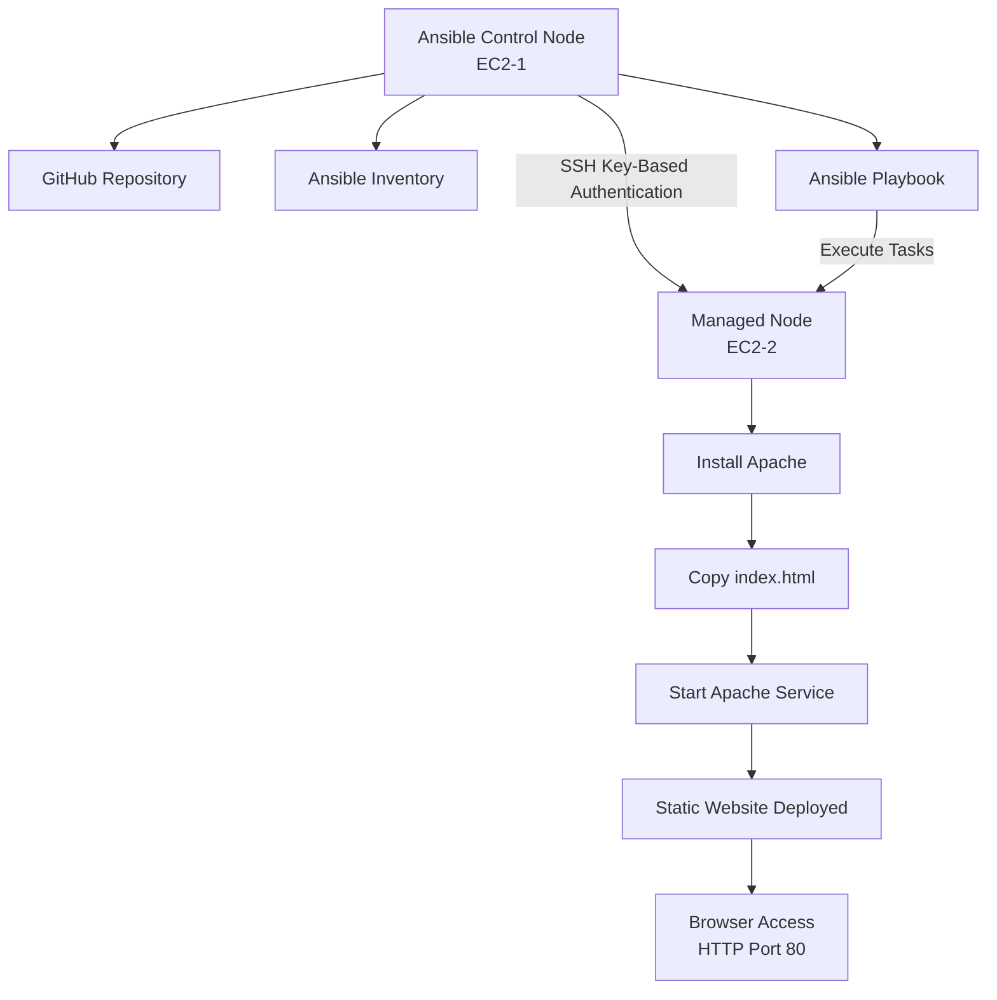

# Project 14: Deploy a Static Website Using Ansible and Apache

## Overview

In this practical, I deployed a static HTML website on an AWS EC2 instance using Ansible.

I used two Ubuntu EC2 instances. One instance acted as the Ansible Control Node and the other acted as the Managed Node.

From the Control Node, I configured SSH key-based authentication, created an Ansible inventory and wrote a playbook to automate Apache installation and website deployment.

The entire deployment was completed using Ansible without manually installing Apache or copying the HTML file to the Managed Node.

## Architecture



## 1. AWS EC2 Instance Setup

I used two Ubuntu EC2 instances.

| Instance | Role | Purpose |
|---|---|---|
| EC2-1 | Control Node | Runs Ansible and executes playbooks |
| EC2-2 | Managed Node | Hosts the static website using Apache |

Both instances were launched in the same AWS region and VPC so they could communicate using their private IP addresses.

I connected to both instances using AWS EC2 Instance Connect through the browser.

**Security Group Configuration**

The following inbound rules were configured:

| Instance | Type | Port | Source | Purpose |
|---|---|---|---|---|
| EC2-1 | SSH | 22 | My IP | SSH access |
| EC2-2 | SSH | 22 | Control Node security group or private network | SSH communication |
| EC2-2 | HTTP | 80 | 0.0.0.0/0 | Website access |

Port 22 was used for SSH communication and port 80 was used to access the website through a browser.

## 2. Install Ansible on the Control Node

I connected to EC2-1 and installed Ansible.

Update the package repository:

```bash
sudo apt update
```

Install Ansible:

```bash
sudo apt install ansible -y
```

Verify the installation:

```bash
ansible --version
```

Ansible was successfully installed on the Control Node.

## 3. Clone the GitHub Repository

I cloned my Ansible learning repository on the Control Node.

```bash
git clone https://github.com/Yuvii2102/My-Ansible-Journey.git
```

Navigate to the practical directory:

```bash
cd My-Ansible-Journey
cd "Day 05 - Practicals"
```

Check the files:

```bash
ls
```

Expected directory structure:

```text
Day 05 - Practicals/
├── README.md
├── first-playbook.yaml
└── index.html
```

The `index.html` file contains the static website that will be deployed on the Managed Node.

## 4. Configure SSH Key-Based Authentication

Ansible uses SSH to communicate with Linux Managed Nodes.

I configured passwordless SSH authentication so the Control Node could connect to the Managed Node without entering an Ubuntu password.

### Step 1: Generate an SSH Key Pair

On EC2-1, generate an Ed25519 SSH key pair:

```bash
ssh-keygen -t ed25519
```

Press Enter to accept the default file location:

```text
/home/ubuntu/.ssh/id_ed25519
```

For this practical, I left the passphrase empty by pressing Enter twice.

Verify the generated keys:

```bash
ls -l ~/.ssh/
```

Two files were generated:

```text
id_ed25519
id_ed25519.pub
```

- `id_ed25519` – Private key. It must remain on the Control Node.
- `id_ed25519.pub` – Public key. It will be added to the Managed Node.

### Step 2: Copy the Public Key

Display the public key on EC2-1:

```bash
cat ~/.ssh/id_ed25519.pub
```

Copy the complete output.

### Step 3: Add the Public Key to the Managed Node

Connect to EC2-2 using AWS EC2 Instance Connect.

Create the SSH directory:

```bash
mkdir -p ~/.ssh
```

Set the directory permissions:

```bash
chmod 700 ~/.ssh
```

Open the authorized keys file using Vim:

```bash
vim ~/.ssh/authorized_keys
```

Press `i` to enter Insert Mode and paste the public key copied from EC2-1.

Save and exit:

1. Press `Esc`.
2. Type `:wq`.
3. Press Enter.

Set the correct file permissions:

```bash
chmod 600 ~/.ssh/authorized_keys
```

### Step 4: Test SSH Connectivity

Return to EC2-1 and connect to EC2-2 using its private IP:

```bash
ssh ubuntu@MANAGED_NODE_PRIVATE_IP
```

Replace the placeholder with the actual private IP of EC2-2.

On the first connection, SSH may ask whether to trust the host key.

Type:

```text
yes
```

This adds the Managed Node's host key to the Control Node's `known_hosts` file.

After successful authentication, the terminal opens on EC2-2 without requesting an Ubuntu password.

Exit the Managed Node:

```bash
exit
```

SSH key-based authentication is now configured.

## 5. Configure the Ansible Inventory

Ansible inventory defines the Managed Nodes that Ansible should control.

Navigate to the practical directory on EC2-1:

```bash
cd ~/My-Ansible-Journey/"Day 05 - Practicals"
```

Create the inventory file using Vim:

```bash
vim inventory.ini
```

Press `i` and add the following configuration:

```ini
[webservers]
web1 ansible_host=MANAGED_NODE_PRIVATE_IP ansible_user=ubuntu ansible_ssh_private_key_file=/home/ubuntu/.ssh/id_ed25519
```

Replace `MANAGED_NODE_PRIVATE_IP` with the private IP address of EC2-2.

Save and exit:

```text
Esc
:wq
Enter
```

The inventory configuration defines:

- `webservers` – Inventory group name.
- `web1` – Name assigned to the Managed Node.
- `ansible_host` – Private IP address of the Managed Node.
- `ansible_user` – SSH username.
- `ansible_ssh_private_key_file` – Private key used for SSH authentication.

## 6. Test Ansible Connectivity

Before executing the playbook, I tested whether Ansible could communicate with the Managed Node.

Execute:

```bash
ansible -i inventory.ini webservers -m ping
```

Expected output:

```text
web1 | SUCCESS => {
    "changed": false,
    "ping": "pong"
}
```

The `ping` module checks Ansible connectivity with the Managed Node.

Receiving `pong` confirms that SSH communication and Ansible connectivity are working.

## 7. Create the Ansible Playbook

I used an Ansible playbook to automate the complete deployment process.

Open the existing playbook using Vim:

```bash
vim first-playbook.yaml
```

Press `i` and add the following YAML configuration:

```yaml
---
- name: Deploy Static Website
  hosts: webservers
  become: true

  tasks:
    - name: Update apt package cache
      ansible.builtin.apt:
        update_cache: yes

    - name: Install Apache
      ansible.builtin.apt:
        name: apache2
        state: present

    - name: Copy HTML file
      ansible.builtin.copy:
        src: index.html
        dest: /var/www/html/index.html
        owner: root
        group: root
        mode: '0644'

    - name: Start Apache service
      ansible.builtin.service:
        name: apache2
        state: started
        enabled: yes
```

Save and exit:

```text
Esc
:wq
Enter
```

### Explanation of the Playbook

| Configuration | Description |
|---|---|
| `hosts: webservers` | Executes tasks on the webservers inventory group |
| `become: true` | Executes tasks with elevated privileges |
| `apt` | Manages Ubuntu packages |
| `update_cache` | Updates the package repository cache |
| `name: apache2` | Specifies the Apache package |
| `state: present` | Ensures Apache is installed |
| `copy` | Copies the HTML file to the Managed Node |
| `src: index.html` | Source file on the Control Node |
| `dest` | Destination directory on the Managed Node |
| `owner: root` | Sets file ownership |
| `group: root` | Sets file group |
| `mode: '0644'` | Sets file permissions |
| `service` | Manages the Apache service |
| `state: started` | Ensures Apache is running |
| `enabled: yes` | Starts Apache automatically during boot |

### Understanding the Ansible Modules

**1. ansible.builtin.apt**

Used to install Apache and update the Ubuntu package cache.

**2. ansible.builtin.copy**

Transfers the `index.html` file from the Control Node to the Apache web directory on the Managed Node.

**3. ansible.builtin.service**

Ensures Apache is running and enabled at system startup.

## 8. Validate the Playbook

Before executing the playbook, I checked the YAML syntax.

```bash
ansible-playbook -i inventory.ini first-playbook.yaml --syntax-check
```

Expected output:

```text
playbook: first-playbook.yaml
```

This confirms that Ansible can parse the playbook without YAML syntax errors.

## 9. Execute the Ansible Playbook

Run the following command from the practical directory on EC2-1:

```bash
ansible-playbook -i inventory.ini first-playbook.yaml
```

Ansible executes the tasks in the order defined in the playbook.

The deployment process:

1. Connects to the Managed Node using SSH.
2. Updates the Ubuntu package cache.
3. Installs Apache.
4. Copies `index.html` to `/var/www/html/index.html`.
5. Starts Apache.
6. Enables Apache during system startup.

After execution, Ansible displays a PLAY RECAP showing the status of each task.

A successful deployment should have:

```text
unreachable=0
failed=0
```

The exact `ok` and `changed` counts may vary depending on the initial state of the Managed Node.

## 10. Configure HTTP Access

To access the deployed website from a browser, I allowed HTTP traffic through the Security Group attached to EC2-2.

Inbound rule:

| Type | Protocol | Port | Source |
|---|---|---|---|
| HTTP | TCP | 80 | 0.0.0.0/0 |

This allows external users to access the website through HTTP.

Port 22 was already configured for SSH communication.

## 11. Verify the Deployment

After executing the playbook, I verified that Apache was running on EC2-2.

### Step 1: Check Apache Status

Connect to the Managed Node and execute:

```bash
sudo systemctl status apache2
```

Expected status:

```text
Active: active (running)
```

### Step 2: Test the Website Locally

Execute:

```bash
curl http://localhost
```

The command should return the HTML content of the deployed website.

### Step 3: Access the Website Through a Browser

Open the following URL:

```text
http://MANAGED_NODE_PUBLIC_IP
```

Replace the placeholder with the public IPv4 address of EC2-2.

The deployed website should display:

- I am learning Ansible
- Ansible Zero to Hero Series
- This is my First Ansible Playbook...
- © 2026 Yuvraj

The website was successfully deployed and accessed through the Managed Node's public IP address.

## 12. Troubleshooting

### Issue 1: SSH Host Key Verification Failed

**Error:**

```text
Host key verification failed.
```

**Reason:**

The Control Node had not yet trusted the Managed Node's SSH host key.

**Solution:**

Connect manually once:

```bash
ssh ubuntu@MANAGED_NODE_PRIVATE_IP
```

Accept the host key when prompted by typing `yes`.

This saves the host key in:

```bash
~/.ssh/known_hosts
```

### Issue 2: Ansible SSH Connectivity Failed

**Reason:**

SSH authentication or network connectivity was not configured correctly.

**Solution:**

- Verify the public key is present in the Managed Node's `~/.ssh/authorized_keys`.
- Check SSH directory permissions.
- Verify the private key path in `inventory.ini`.
- Ensure port 22 is allowed in the Managed Node's Security Group.
- Test SSH manually from the Control Node.

### Issue 3: Website Not Accessible Through Browser

**Symptom:**

```text
ERR_TIMED_OUT
```

**Verification:**

Check Apache status:

```bash
sudo systemctl status apache2
```

Test locally:

```bash
curl http://localhost
```

**Solution:**

If Apache is running and localhost returns the HTML content, verify the Managed Node's Security Group.

Make sure inbound HTTP traffic on port 80 is allowed.

### Issue 4: Python Interpreter Warning

Ansible may display a warning about Python interpreter discovery.

This warning does not necessarily indicate a failure.

If the Ansible ping command returns:

```text
"ping": "pong"
```

the connection is successful.

## 13. Final Result

Successfully deployed a static HTML website on an AWS EC2 instance using Ansible automation.

The Control Node managed the complete deployment process through SSH and an Ansible playbook.

Apache was installed, the HTML file was transferred and the web server was started automatically.

**Final Architecture:**

```text
Control Node (EC2-1)
        |
        | SSH Authentication
        |
        v
Managed Node (EC2-2)
        |
        v
Ansible Playbook
        |
        v
Install Apache
        |
        v
Copy index.html
        |
        v
Start Apache
        |
        v
Static Website Live
        |
        v
Browser Access (HTTP :80)
```

## 14. Key Learnings

Through this practical, I learned:

- How to configure an Ansible Control Node and Managed Node.
- How SSH key-based passwordless authentication works.
- How to configure an Ansible inventory.
- How to test connectivity using Ansible ad-hoc commands.
- How to write and execute an Ansible playbook.
- How to use the APT, Copy and Service modules.
- How to automate Apache installation and configuration.
- How to deploy a static website using Ansible.
- How AWS Security Groups control SSH and HTTP traffic.
- How to verify and troubleshoot a deployment.

**Tools and Technologies Used:**

- AWS EC2
- Ubuntu Linux
- Ansible
- SSH
- YAML
- Apache2
- Git and GitHub
- HTML and CSS

**Project Status: Successfully Completed**
